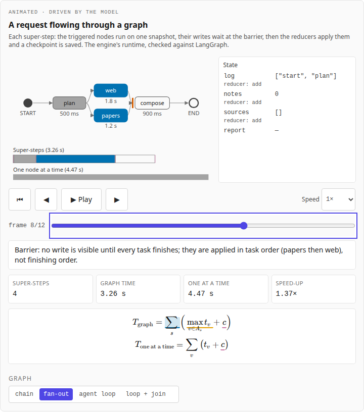
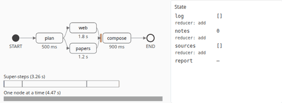
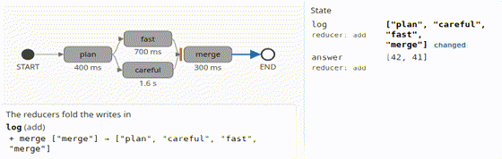
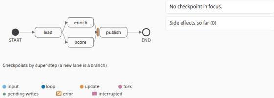
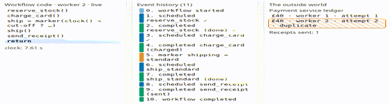
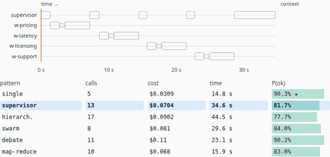
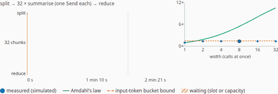
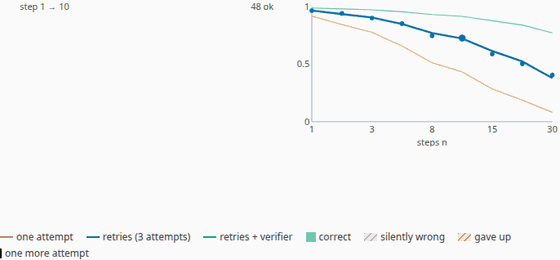
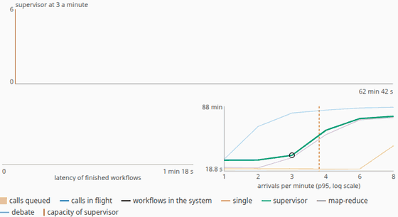
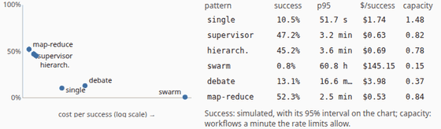

# Agent Orchestration Explained

**Live:** https://agent-orchestration-explained.vercel.app

Multi-step and multi-agent systems as **discrete-event systems**. Chapters 1–4 take apart
[LangGraph](https://github.com/langchain-ai/langgraph)'s execution model (graphs and Pregel-style super-steps,
state channels and reducers, checkpoints, interrupts and time travel) and then **durable execution**: replaying a
workflow's event history after a crash, what a non-deterministic step does to the replay, and how an idempotency
key turns at-least-once execution into one charge. Chapters 5–9 compare multi-agent patterns (supervisor,
hierarchical, swarm, debate, map-reduce) on tokens, latency and success, fan workers out under a rate limit, work
out reliability with retries and verifiers, run hundreds of workflows against one rate-limited endpoint in a
discrete-event simulation, and turn the results into a guide for choosing a pattern. Each chapter is built around an animation, with the maths beside
the picture, driven by [Agent_Loop_Sim](https://github.com/BrendanJamesLynskey/Agent_Loop_Sim)'s orchestration
module, identically in Python and in the browser.

The engine's graph runtime is **checked against real LangGraph**: in the engine's CI, 39 sessions (71 operations:
runs, crashes, resumes, `Send` fan-outs, `interrupt()` and `Command(resume=…)`, static interrupts, `update_state`, time travel) are
built as real `StateGraph`s and run in **langgraph 1.2.14**, and after every operation the whole checkpoint history
(232 checkpoints at the end: step, source, parent, state, next tasks, each task's result, error and interrupts)
must equal the engine's. No language model runs on the site or in CI.



Part of a family of companion sites, in four tracks (Foundations, Hardware, Inference, Agents); every
header shows where you are as "Track › Site". Agents: [Agent Harnesses Explained](https://agent-harnesses-explained.vercel.app),
[Agent Protocols Explained](https://agent-protocols-explained.vercel.app),
[Agent Context Explained](https://agent-context-explained.vercel.app), this one, then
[Agent Evals Explained](https://agent-evals-explained.vercel.app). Foundations (one small model, end to end): Decoder, the
[Transformer Decoder Explainer](https://transformer-decoder-explained.vercel.app), and
[Training](https://transformer-training-explained.vercel.app). Hardware:
[GPU Kernels Explained](https://gpu-kernels-explained.vercel.app),
[Systolic Arrays Explained](https://systolic-arrays-explained.vercel.app) (Silicon) and
[AI Racks Explained](https://ai-racks-explained.vercel.app) (Racks).
Inference: Serving,
[LLM Inference Explained](https://llm-inference-explained.vercel.app),
[LLM Architectures Explained](https://llm-architectures-explained.vercel.app),
[Numerics Explained](https://numerics-explained.vercel.app),
[Inference Trade-offs Explained](https://inference-tradeoffs-explained.vercel.app).

## Chapters

| #   | Chapter                                                                                                               | The animation                                                                                                                                                          |
| --- | --------------------------------------------------------------------------------------------------------------------- | ---------------------------------------------------------------------------------------------------------------------------------------------------------------------- |
| 1   | [From a chain to a graph](https://agent-orchestration-explained.vercel.app/learn/01-from-a-chain-to-a-graph)          | A request flowing through a chain, a fan-out, an agent loop and a loop with a join, super-step by super-step, with the state and a time strip                          |
| 2   | [State, channels and reducers](https://agent-orchestration-explained.vercel.app/learn/02-state-channels-and-reducers) | Two branches write one key: no reducer (InvalidUpdateError), add, max, folded write by write at the barrier; and what a router sees                                    |
| 3   | [Checkpoints and interrupts](https://agent-orchestration-explained.vercel.app/learn/03-checkpoints-and-interrupts)    | A crash and resume, a human interrupt, a static interrupt and an edit, and two kinds of time travel, on a tree of checkpoints                                          |
| 4   | [Durable execution](https://agent-orchestration-explained.vercel.app/learn/04-durable-execution)                      | An order workflow, its event history and the outside world under five faults, with and without an idempotency key, with a clock read or a marker                       |
| 5   | [Multi-agent patterns](https://agent-orchestration-explained.vercel.app/learn/05-multi-agent-patterns)                | Single agent, supervisor, hierarchical, swarm, debate and map-reduce on one task: every call on a timeline, each agent's context, tokens, cost, latency and P(success) |
| 6   | [Fan-out and map-reduce](https://agent-orchestration-explained.vercel.app/learn/06-fan-out-and-map-reduce)            | Workers queueing for a token bucket: the speed-up against Amdahl's law and the rate-limit ceiling as the fan-out widens                                                |
| 7   | [Reliability](https://agent-orchestration-explained.vercel.app/learn/07-reliability)                                  | Success decaying with the step count; retries and a verifier pushing it back up, closed forms beside seeded runs and 95% intervals                                     |
| 8   | [Running at scale](https://agent-orchestration-explained.vercel.app/learn/08-running-at-scale)                        | Hundreds of workflows sharing one rate-limited endpoint: the queue, retries, tail latency and cost per success as load passes capacity                                 |
| 9   | [Choosing a pattern](https://agent-orchestration-explained.vercel.app/learn/09-choosing-a-pattern)                    | Constraints on success, p95, cost and throughput striking patterns out of the simulated table until one is left                                                        |

The animations, recorded frame by frame from the engine's states (`pnpm animations`; WebM versions beside them in
[`docs/media`](docs/media)):

| Super-steps                                                                           | Reducers                                                             | Checkpoints                                                                           |
| ------------------------------------------------------------------------------------- | -------------------------------------------------------------------- | ------------------------------------------------------------------------------------- |
|               |          |  |
| **Durable execution**                                                                 | **Patterns**                                                         | **Fan-out**                                                                           |
|                     |         |                          |
| **Reliability**                                                                       | **At scale**                                                         | **Choosing**                                                                          |
|  |  |                           |

## Results

From the engine's recorded run ([`orchestration_results.md`](src/data/orchestration_results.md), vendored); node
durations and the 15 ms checkpoint write are illustrative, the super-steps are LangGraph's:

| Graph       | Super-steps | Graph time | One node at a time | Speed-up |
| ----------- | ----------- | ---------- | ------------------ | -------- |
| chain       | 4           | 2,860 ms   | 2,860 ms           | 1.00     |
| fan-out     | 4           | 3,260 ms   | 4,475 ms           | 1.37     |
| agent loop  | 6           | 3,590 ms   | 3,590 ms           | 1.00     |
| loop + join | 7           | 2,905 ms   | 3,935 ms           | 1.35     |

| Finding                                                     | From the runs                                                                                                                                    |
| ----------------------------------------------------------- | ------------------------------------------------------------------------------------------------------------------------------------------------ |
| Parallel writes are applied in task order, not finish order | `careful` (1.6 s) and `fast` (0.7 s) both append to `answer`: the result is `[42, 41]`; with no reducer the step fails with `InvalidUpdateError` |
| A router sees its own node's writes only                    | `p`'s router does not see its sibling's `x = 7`, so `r` never runs                                                                               |
| An interrupted node runs again from its first line          | the reviewer is notified twice across `interrupt()` and `Command(resume=…)`; the finished sibling is not re-run                                  |
| A crash keeps the finished siblings' writes                 | resume re-runs only the failed node                                                                                                              |
| A crash inside a side effect repeats it                     | 2 charges (£80) without an idempotency key, 1 with it; a lost reply and a retry likewise                                                         |
| A clock read in workflow code breaks replay                 | a non-determinism error at the first command that differs; recording the choice as a marker fixes it                                             |
| Closed forms against simulation                             | without a key E[charges] = (1 − q^A)/(1 − q), P(two or more) = q; the seeded sweep agrees within four standard errors (engine tests)             |

Part 2 (engine 1.7.0, [`orchestration2_results.md`](src/data/orchestration2_results.md), vendored); task sizes,
accuracy, latency, rate limits and failure rates are illustrative, prices are the engine's dated list prices:

| Pattern (4 sub-questions, 700-token tool results) | Model calls | Input tokens | Cost ($) | Latency (s) | P(success) |
| ------------------------------------------------- | ----------- | ------------ | -------- | ----------- | ---------- |
| single                                            | 5           | 12,700       | 0.0309   | 14.8        | 0.903      |
| supervisor                                        | 13          | 19,640       | 0.0704   | 34.6        | 0.817      |
| hierarchical                                      | 17          | 23,590       | 0.0902   | 44.5        | 0.777      |
| swarm                                             | 8           | 24,040       | 0.0810   | 29.6        | 0.840      |
| debate                                            | 11          | 37,020       | 0.1140   | 23.1        | 0.902      |
| map-reduce                                        | 10          | 14,480       | 0.0680   | 15.9        | 0.830      |

| Finding                               | From the runs                                                                                                                            |
| ------------------------------------- | ---------------------------------------------------------------------------------------------------------------------------------------- |
| A bigger task favours splitting it    | with 16 sub-questions and 1,500-token results the single agent's P(success) falls to 0.112, map-reduce keeps 0.506                       |
| Fan-out saturates at the token bucket | 32 chunks: at 40,000 input tokens a minute the speed-up stops at 1.38 (ceiling 1.49); at 200,000 it follows Amdahl to 10.58 at width 32  |
| Success decays with the step count    | 20 steps: 0.1887 with no recovery, 0.5250 with retries, 0.8425 with a verifier (closed forms, each inside its seeded runs' 95% interval) |
| Past capacity the tail explodes       | supervisor, capacity 3.80 workflows a minute: p95 43.4 s at 2 a minute, 644.8 s at 4                                                     |
| The choice follows the constraints    | 16 sub-questions, success ≥ 0.4 and p95 ≤ 180 s: only map-reduce survives                                                                |

The [data page](https://agent-orchestration-explained.vercel.app/data) lists every conformance session and every run.

## The engine

The site vendors Agent_Loop_Sim's TypeScript port at a pinned commit (`pnpm vendor:engine <sha>`;
`src/lib/engine/vendor/VENDORED.json` records the commit and each file's SHA-256) and runs its `orchestration`
module (engine 1.7.0) in the page: a graph runtime (state channels with reducers, nodes as deterministic operation
lists, static, join and conditional edges, super-steps, checkpoints, pending writes, dynamic and static interrupts,
`update_state`, replay and fork, `Send` for map-reduce), a durable-execution model (event history, replay, markers, idempotency keys,
lost replies and retries, a seeded sweep), and the views the animations draw (super-step frames, reducer folds,
checkpoint timelines, a layered graph layout), multi-agent patterns with per-agent context and token accounting, a seeded
discrete-event simulation of workflows against a rate-limited endpoint (requests, input and output tokens a minute,
concurrency, retries with full-jitter backoff, timeouts) and reliability closed forms checked against Monte Carlo. Python and TS agree exactly. This site's CI installs the reference at
the vendored commit, regenerates `tests/fixtures/site_fixtures.json` and requires the port to reproduce it, and checks
the committed LangGraph recording against the reference.

## What is illustrative

Node durations and the checkpoint write; the graphs, their state and their side effects; chapter 4's workflow,
payment service, shipping cut-off and times (2,000 ms reply timeout, 5,000 ms restart), and its simplified event
history (in the style of durable-execution engines such as [Temporal](https://docs.temporal.io/workflows), not any
engine's format). Chapters 5–9: the task, the agents' prompt and tool-result sizes, the accuracy model (falling
with context length), the error rates and the verifier, the latency profile, the rate limits (deliberately small)
and the failure rate; prices are the engine's dated list prices. The order of writes, what each node sees, which nodes run in which step and every checkpoint are
LangGraph's, as recorded.

## Checks

| Check                                                                                                                                                                                        | Where                                                                        |
| -------------------------------------------------------------------------------------------------------------------------------------------------------------------------------------------- | ---------------------------------------------------------------------------- |
| Python reference regenerates the site's fixtures; vendored hashes; the LangGraph recording equals the reference                                                                              | CI "Model and fixtures" (`scripts/make_fixtures.py --check`, `tests/python`) |
| TS engine = Python reference on everything each chapter animates, exactly; key frames; chapters' code, equations, links and values                                                           | CI "Unit Tests" (`tests/unit`)                                               |
| Every page at 1,280 and 390 px, light and dark: no errors, no overflow; every animation plays, steps, scrubs, resets, keys; reduced motion; frame captions on the page; axe; the site switch | CI "E2E Tests" (`tests/e2e`)                                                 |
| Lighthouse ≥ 0.9 (performance, accessibility, best practices)                                                                                                                                | CI "Lighthouse"                                                              |
| LangGraph conformance, re-recorded live in pinned langgraph 1.2.14                                                                                                                           | Agent_Loop_Sim CI (`scripts/record_langgraph.py --check`)                    |

## Develop

```bash
pnpm install
pnpm dev                                    # http://localhost:3000
pnpm test && pnpm lint && pnpm typecheck
python3 -m venv .venv && .venv/bin/pip install -r reference/requirements.txt
.venv/bin/python scripts/make_fixtures.py --check
pnpm test:e2e                               # builds, then serves under --no-experimental-require-module
```

Deploying, smoke checks and updating the engine: [RUNBOOK.md](RUNBOOK.md).

## Origin

The structure, animation infrastructure (`useStepper`, `AnimationPanel`, the clock), MDX pipeline, CI, checks and
the four-track site switch are copied from
[agent-context-explained](https://github.com/BrendanJamesLynskey/agent-context-explained) (itself from
agent-protocols-explained, agent-harnesses-explained and gpu-kernels-explained); the engine vendoring follows
llm-inference-explained.

## Licence

MIT. Third-party files and their licences: [NOTICE](NOTICE).
